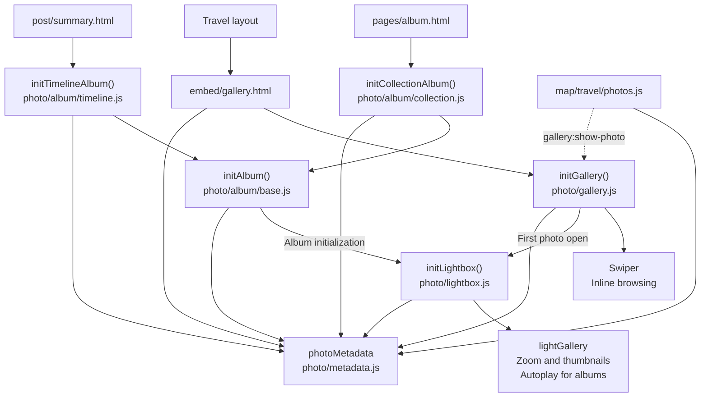
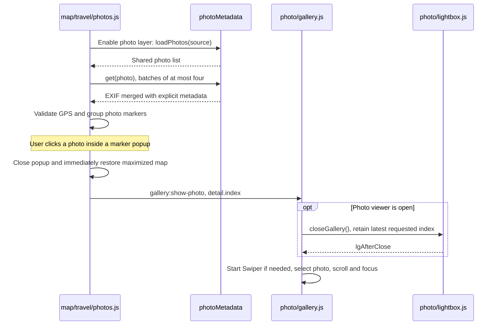
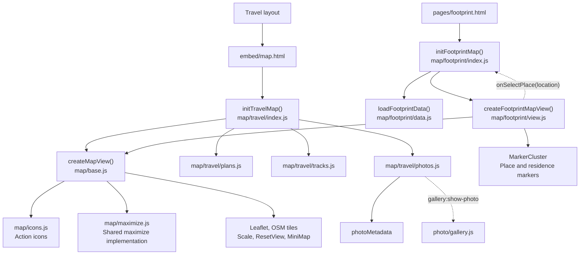
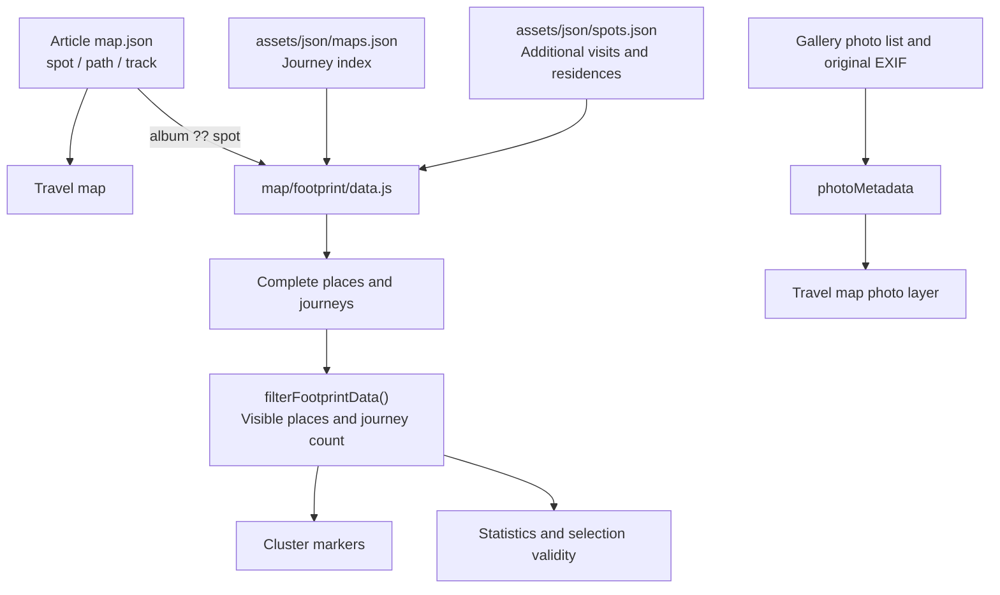

# Photo and map controls

This document describes the current implementation. Both parts use the same six sections. Solid diagram arrows indicate initialization, calls, or data flow; dotted arrows indicate interaction callbacks or events. File paths are relative to the repository root; abbreviated `photo/` and `map/` paths in diagrams refer to `assets/js/`.

## Contents

| Section | Photo controls | Map controls |
| --- | --- | --- |
| Overview | [Photos](#photos-overview) | [Maps](#maps-overview) |
| Page assembly and dependencies | [Photos](#photos-assembly) | [Maps](#maps-assembly) |
| Data and shared APIs | [Photos](#photos-data) · [`pic.json` definition](#picjson-file-definition) | [Maps](#maps-data) · [`map.json` definition](#mapjson-file-definition) |
| Interaction flows | [Photos](#photos-interactions) | [Maps](#maps-interactions) |
| Styles and icons | [Photos](#photos-styles) | [Maps](#maps-styles) |
| Maintenance and verification | [Photos](#photos-maintenance) | [Maps](#maps-maintenance) |

The implementations use ordinary scripts and global functions, rather than ES module imports. `_includes/head.html` loads dependencies in order; page templates supply Liquid-generated URLs and configuration. `assets/js/json.js` provides `asyncLoadJSON()`, which checks HTTP responses and JSON parsing. Specialized modules decide whether to cache results or recover from failures.

## Photo controls

<a id="photos-overview"></a>

### 1. Overview

Three entry points share the `initLightbox()` implementation. Each initialized gallery or album has its own lightGallery instance; there is no single global photo viewer instance. Swiper is used only for the travel page's inline gallery.



| Entry point | Inline presentation | Organization | Viewer configuration |
| --- | --- | --- | --- |
| Travel gallery | Photo stage, fitted inner frame, count, and metadata | Current article's `pic.json`, in source order | No looping or autoplay; gallery restores scroll and focus after closing |
| Collection album | Photo cards, ordering controls, and photo/journey totals | `album.json` index followed by each photo list; shuffle, ascending, or descending article date | Looping; autoplay control available, slideshow does not start automatically |
| Timeline album | Monthly cards, monthly count chart, and daily/travel filters | Summary's daily photos plus supplied travel sources; date range, sorting, and deduplication | Looping; autoplay control available; viewer list follows current filters |

<a id="photos-assembly"></a>

### 2. Page assembly and dependencies

`_includes/head.html` applies these conditions:

| Condition | Scripts and libraries |
| --- | --- |
| `required` contains `gallery` or `album`, or layout is `post/travel` | lightGallery, Zoom/Autoplay/Thumbnail plugins, exifr, `photo/metadata.js`, then `photo/lightbox.js` |
| `required` contains `gallery`, or layout is `post/travel` | Swiper, then `photo/gallery.js` |
| `required` contains `album` | `photo/album/base.js`, then `timeline.js` for `post/summary`; otherwise `collection.js` |

The outer photo dependency condition also encloses the gallery and album branches. Loading the Autoplay script does not enable autoplay in every viewer: `initLightbox()` includes that plugin only when its `autoplay` option is true.

| Template | Assembly responsibility |
| --- | --- |
| `_layouts/post/travel.html` | Embeds `` and ``; `_plugins/embed_wrapper.rb` routes these tags to `_includes/embed/` |
| `_includes/embed/gallery.html` | Creates the container with `data-gallery-source`, calls `photoMetadata.loadPhotos(source)`, then `initGallery(id, photos)` |
| `pages/album.html` | Calls `initCollectionAlbum(id, indexURL)`; also supplies the independent Devices dialog |
| `_layouts/post/summary.html` | Generates daily/travel source URLs, dates, article links, and an inclusive month range for `initTimelineAlbum()` |

The gallery template requests the photo list immediately. Swiper starts when the gallery approaches the viewport, using an IntersectionObserver with a `200px` root margin, or when a map event needs to locate a photo sooner. This does not enable the map's photo layer or read every photo's GPS.

<a id="photos-data"></a>

### 3. Data and shared APIs

#### `pic.json` file definition

The conventional location is `assets/src/<article-slug>/pic.json`. The top-level value is a JSON array of photo objects, not an object wrapping a `photos` property. Array order determines the travel gallery's order and the indices used by map-to-gallery events. An empty array is valid and produces an empty gallery; collection and timeline apply their own ordering rules.

| Field | Expected JSON type | Required | Meaning and consumers |
| --- | --- | --- | --- |
| `src` | string | Yes, for each entry | Original image URL. Used by the viewer, EXIF reader, album cards, and map popups. Prefer a site-root-relative path such as `/assets/src/<slug>/pic/photo.avif`, or an absolute URL |
| `loc` | string | No | Location text used by gallery details, photo markers, and caption fallbacks. This is display text, not a coordinate lookup into `map.json` |
| `title` | string | No | First choice for the travel gallery heading and the shared heading fallback |
| `caption` | string | No | Gallery heading fallback and album caption input. Collection can preserve it; timeline generates its own captions |
| `alt` | string | No | Alternative text for gallery/viewer images; falls back to the shared heading. Album card image alt text uses the normalized card caption |
| `preview` | string | No | Inline travel image URL; falls back to `src`. Also used as the viewer thumbnail fallback after `thumb` |
| `thumb` | string | No | Viewer thumbnail URL; falls back to `preview`, then `src` |
| `width`, `height` | number | No | Positive original-image dimensions in pixels. Supply both to establish a frame/card aspect ratio before the image loads; natural dimensions take over after loading |
| `link` | string | No | Preferred location/title link if it resolves to HTTP(S); otherwise valid GPS supplies the link. Collection replaces it with its article URL |
| `exif` | object | No | Explicit metadata in the normalized format below, merged over extracted original-image EXIF |
| `lightboxCaption` | string | No | Optional viewer-specific title, mainly supplied by album normalization. Timeline replaces it with its generated title; the travel gallery's inline heading does not use it |
| `lightboxLink` | string | No | Optional viewer-specific link, preferred over `link` in the lightbox. Timeline supplies its journey link; inline location links do not use this field |

`src`, `preview`, and `thumb` are resolved through `photoMetadata.resolveURL()`. Site-root-relative asset paths receive `site.baseurl`; absolute and protocol-relative URLs are preserved. Preview/thumbnail files should represent the same photo as `src`, because metadata and GPS are always read from the original. Gallery and album entries are copied when enriched with view-specific fields; runtime fields such as `month`, `journey`, `galleryIndex`, and collection article `date` are not required in source JSON.

The optional `exif` object uses application field names, not raw EXIF tag names such as `Model` or `GPSLatitude`:

| `exif` field | Expected JSON type | Unit or accepted value |
| --- | --- | --- |
| `cameraModel`, `lensModel` | string | Camera/lens display names |
| `fNumber` | number | Aperture number, e.g. `2.8` |
| `exposureTimeSeconds` | number | Exposure duration in seconds, e.g. `0.004` for 1/250 s |
| `iso` | number | ISO sensitivity, e.g. `100` |
| `focalLengthMm` | number | Focal length in millimeters |
| `exposureBiasEv` | number | Signed exposure compensation in EV; `0` is meaningful |
| `meteringMode` | number or string | EXIF mode code, recognized name, or abbreviation. Codes `1`–`6` map to Average, Center-weighted, Spot, Multi-spot, Multi-segment, and Partial; `0` and `255` represent Unknown and Other |
| `dateTimeOriginal` | string | Camera-local timestamp, typically `YYYY:MM:DD HH:mm:ss` or `YYYY-MM-DDTHH:mm:ss`; the display formats through minutes |
| `latitude`, `longitude` | number | Signed decimal degrees, latitude first when paired; valid GPS requires finite values within ±90 and ±180 respectively |

These are the fields expected by the consumers, not a runtime JSON Schema. `loadPhotos()` reads/caches the parsed value without validating every entry. Use correctly typed values and a usable `src`; omit unavailable metadata or set it to `null` rather than using empty strings to suppress extracted values accidentally. A photo does not need GPS to appear in a gallery or album, but it needs valid GPS after the EXIF merge to appear in the map's photo layer.

Illustrative file (replace the example asset paths with actual files):

```json
[
  {
    "src": "/assets/src/example-trip/pic/bridge.avif",
    "loc": "Riverside bridge"
  },
  {
    "src": "/assets/src/example-trip/pic/park.avif",
    "preview": "/assets/src/example-trip/preview/park.avif",
    "thumb": "/assets/src/example-trip/thumb/park.avif",
    "loc": "Riverside park",
    "title": "Evening light",
    "alt": "Sunset over a riverside path",
    "width": 4032,
    "height": 3024,
    "exif": {
      "cameraModel": "Example camera",
      "fNumber": 2.8,
      "exposureTimeSeconds": 0.004,
      "iso": 100,
      "focalLengthMm": 35,
      "exposureBiasEv": 0,
      "meteringMode": 5,
      "dateTimeOriginal": "2026:10:31 16:22:00",
      "latitude": 35.7823,
      "longitude": 139.7451
    }
  }
]
```

For a timeline's **daily** source, use filenames such as `20261031-1.avif` instead of the illustrative travel filenames above: that consumer derives date and sequence from `YYYYMMDD-N.ext`. Travel sources use the supplied article date and do not require this filename convention.

#### Shared metadata and view data

`photoMetadata` is shared by the inline gallery, albums, lightbox, and travel map.

| API | Current behavior |
| --- | --- |
| `loadPhotos(url)` | Resolves an absolute URL and shares the in-flight or completed photo-list Promise within the page. A failed request is removed from this cache so a later call can retry |
| `get(photo)` | Shares an EXIF Promise by the resolved original-image `src`. Extracted fields are merged with explicit `photo.exif` fields whose values are neither `null` nor `undefined` |
| `resolveURL(src)` | Preserves absolute/protocol-relative URLs; prefixes other photo asset paths with the Jekyll base URL |
| `heading(photo)` | Returns the first nonempty `title`, `caption`, or `loc`, then the literal text `null` |
| `format(metadata)` | Formats camera, lens, date, and exposure fields; missing display values use the literal text `null` |
| `parameters` | Defines the shared order and labels: aperture, shutter, ISO; focal length, exposure compensation, metering |
| `renderMetering(values)` | Uses the metering SVG sprite for six known modes; otherwise renders the appropriate text |
| `renderLocation(photo, metadata, label)` | Uses a valid HTTP(S) article link first, otherwise valid GPS coordinates for a Google Maps link, otherwise plain text |

The two caches have different failure behavior. Photo-list failures remain retryable. EXIF parsing failures are caught inside the cached Promise and resolve to `{}`; they do not automatically retry. Explicit metadata still overlays that result. EXIF requests use the original asset URL with `photo-exif=1`; they do not parse the gallery preview image. The EXIF cache key is the string returned by `resolveURL()`, whereas photo-list cache keys are absolute URLs.

Camera-local timestamps without an offset retain their displayed local date/time. Units are attached directly to values, such as `1/2500s`, `14mm`, and `0EV`. Empty strings in explicit EXIF are not filtered out by `get()` and can therefore replace extracted values.

| Source or view | Data and caption rules |
| --- | --- |
| Collection | Reads `assets/json/album.json`, then all indexed lists with `Promise.all()`. Each copied entry receives article title as `loc`, article timestamp as `date`, and article URL as `link`. Ordering uses that article timestamp, not photo EXIF |
| Collection captions | `initAlbum()` preserves an existing non-null `caption`; otherwise it uses `loc` (the indexed article title). A supplied `lightboxCaption` is preserved; otherwise it is derived from caption/location |
| Timeline daily photos | Date and sequence come from `YYYYMMDD-N.ext`; invalid dates or sequences throw. Date range checks use inclusive `YYYY-MM` bounds |
| Timeline travel photos | Date comes from the supplied article date; source order supplies the within-article sequence. Sources with an article `link` are treated as travel sources |
| Timeline ordering | Sorts by date, source order, and sequence; then deduplicates by the raw `src` string. Different URL spellings are not canonicalized for deduplication |
| Timeline captions | Cards prefer location, then journey title, then month. Travel viewer captions combine journey title and location and link to the article; daily viewer captions use location or month |
| Travel gallery | Preserves the list's order. Its heading follows `heading()`; a separate location line appears when a title/caption and location are both present |

Timeline list requests use `Promise.allSettled()`, allowing successfully loaded sources to remain visible with a partial-failure message. Collection list loading uses `Promise.all()` and reports initialization failure if any source rejects. Both create copied arrays/entries for their own organization instead of reordering the cached lists.

<a id="photos-interactions"></a>

### 4. Interaction flows

The travel gallery supports dragging, swiping, and direction-aware arrow keys. CSS supplies `--gallery-direction`; ResizeObserver synchronizes Swiper and fitted frames with that container layout. Clicking a neighboring photo selects it; clicking the current photo opens the viewer. Failed images offer a retry. Ordinary navigation uses `300ms`; internal synchronization and direction changes position immediately.

The gallery creates its lightbox on first open with `loop: false` and `resetScrollPosition: false`. It owns restoration of page scroll and current-photo focus. Fullscreen slide changes synchronize the inline selection; there is no corresponding automatic map movement.

The map-to-gallery link is intentionally one-way:



`detail.index` is zero-based and refers to the source gallery's list. The map records this index before grouping photos by GPS. A map popup click locates the inline photo; opening lightGallery is a separate click on that photo. Metadata location links are independent links, not Leaflet positioning events. See [map interaction flows](#maps-interactions) for layer loading and footprint map selection.

Collection cards open their matching viewer index. Changing collection order updates `?order=` and reloads the page. Timeline filtering rebuilds the cards and monthly chart, calling `album.setPhotos()` before creating new cards so their indices match the viewer list. Its chart links scroll to months that currently contain photos.

The lightbox always shows location/title, camera, and date. A Font Awesome information button expands lens and the six shared parameters. Expanded state survives slide changes but resets after closing. Collapsed detail panels are inert and hidden from assistive technology. Async metadata updates check the current photo, viewer-open state, and index before replacing captions; ResizeObserver refreshes lightGallery measurements when its content changes. Thumbnails are enabled at initialization only when the initial list contains fewer than 50 photos.

<a id="photos-styles"></a>

### 5. Styles and icons

`assets/main.scss` loads `_sass/custom.scss`, which loads `custom/photo/_index.scss`.

```text
_sass/custom/photo/
  _index.scss
  _preview.scss          Shared hover effect and fullscreen hint
  _gallery.scss          Travel stage, inner frames, details, container layout
  _lightbox.scss         Viewer layout, information panel, controls, thumbnails
  album/
    _index.scss
    _base.scss           Cards, aspect ratios, single-line captions
    _collection.scss     Collection layout and ordering controls
    _timeline.scss       Month groups, chart, daily/travel styling
    _devices.scss        Independent Devices dialog
```

Gallery and album styles reuse the `interactive` mixin and `.photo-fullscreen-hint` from `_preview.scss`: slight image enlargement and a corner fullscreen hint, with the hint kept visible on touch devices. The gallery's interactive frame fits the actual image inside Swiper's fixed slide area. Gallery direction follows its container layout rather than a separate JavaScript viewport threshold.

Viewer actions and inline fullscreen hints use Font Awesome. Metering uses `assets/img/photo/metering.svg`, with labels, abbreviations, and mode mappings in `photo/metadata.js`. The custom cursor is managed separately by `assets/js/cursor.js` and `custom/cursor.scss`; lightGallery and Leaflet use native cursor handling.

The Album page's Devices dialog does not call `initAlbum()` or `initLightbox()`. `pages/album.html` builds it from `_data/devices.yml`; `assets/js/modal.js` handles opening/closing. `photo/album/devices.js` observes visible device pages inside the open dialog, caches parsed SVG sources, and mounts fresh copies for each visit. Requests that finish after the visit ends do not replace the current illustration.

<a id="photos-maintenance"></a>

### 6. Maintenance and verification

| Change | Main files |
| --- | --- |
| Inline travel selection, frames, keyboard handling, map event receiver | `assets/js/photo/gallery.js`, `_sass/custom/photo/_gallery.scss` |
| Shared card creation and viewer-list replacement | `assets/js/photo/album/base.js`, `_sass/custom/photo/album/_base.scss` |
| Collection ordering, sources, and totals | `assets/js/photo/album/collection.js`, `assets/json/album.json` |
| Timeline dates, grouping, filters, captions, and article links | `assets/js/photo/album/timeline.js`, `_layouts/post/summary.html` |
| Viewer controls, captions, details, and autoplay options | `assets/js/photo/lightbox.js`, `_sass/custom/photo/_lightbox.scss` |
| Shared lists, EXIF, formatting, metering, and location links | `assets/js/photo/metadata.js`, `assets/img/photo/metering.svg` |
| Shared hover and fullscreen hint | `_sass/custom/photo/_preview.scss` |
| Devices dialog | `pages/album.html`, `_data/devices.yml`, `assets/js/photo/album/devices.js`, `assets/js/modal.js` |
| Dependencies and entry-point loading | `_includes/head.html`, `_includes/embed/gallery.html` |

For photo changes, build the site and check travel gallery navigation, wide/narrow container layouts, image retry, viewer open/close with scroll/focus restoration, and metadata updates during rapid slide changes. For albums, also check collection URL ordering and timeline filtering, empty results, partial source failures, and card/viewer index alignment. For shared metadata changes, verify repeated list reads, GPS markers, explicit EXIF overrides, missing fields, and article/GPS links.

`metadata.js` and `lightbox.js` contain Jekyll front matter, and metadata URL resolution contains Liquid. Syntax-check their generated JavaScript after building rather than passing the raw template directly to `node --check`.

[Back to contents](#contents)

## Map controls

<a id="maps-overview"></a>

### 1. Overview

The shared subsystem is named **map**. Its two controls are **travel map** and **footprint map**. All map JavaScript lives under `assets/js/map/`; all map SCSS lives under `_sass/custom/map/`. Shared modules are at the root, and specialized modules are in `travel/` and `footprint/`.



Both maps use the same base and maximize implementation, while retaining separate Leaflet instances and business logic. The map base does not interpret journey JSON, look for photo galleries, or render footprint details.

| Control | Initial view | Map content | Page interaction |
| --- | --- | --- | --- |
| Travel map | Bounds covering journey places and valid GPX tracks | Place markers, plan sections, track toggles, optional photo layer | Photo popup locates the inline gallery |
| Footprint map | Fixed center near Beijing, zoom 4 | Clustered places and residence markers | Date filters, place/journey counts, location details, related journeys |

<a id="maps-assembly"></a>

### 2. Page assembly and dependencies

The map branch in `_includes/head.html` runs when `required` contains `map` or the layout is `post/travel`.

| Condition within that branch | Loading order |
| --- | --- |
| All map pages | Leaflet, MiniMap, ResetView; then `map/icons.js`, `map/maximize.js`, `map/base.js` |
| `required` contains `markercluster` | MarkerCluster library and styles, before the map modules |
| `page.permalink == "/footprint"` | `map/footprint/data.js`, `view.js`, `index.js` |
| Other map pages | `map/travel/plans.js`, `tracks.js`, `photos.js`, `index.js` |

`_includes/embed/map.html` loads the article's `map.json` and calls `initTravelMap(mapId, mapData, baseURL)`. The initializer waits for DOMContentLoaded when necessary because gallery containers can appear after its inline script. A standalone map embed also needs the map dependency condition to be satisfied, typically through `required: map`.

`pages/footprint.html` contains the dashboard structure, detail/ticket templates, and Liquid-generated `mapsURL`/`spotsURL`; it calls `initFootprintMap(options)`. Its filter controls, statistics, and detail tickets are part of the footprint map implementation. The page's recent-journey cards are rendered separately by Liquid and are not rebuilt by the map's date filter.

Photo dependencies are separate from map dependencies. A standalone map without `photoMetadata`, or without a nonempty gallery source, does not register the photo layer.

<a id="maps-data"></a>

### 3. Data and shared APIs

#### `map.json` file definition

The conventional location is `assets/src/<article-slug>/map.json`. The top-level value is a JSON object. Travel map reads `spot`, `path`, and `track`; footprint map reads `album ?? spot` from the same file and obtains journey metadata from its separate index.

| Field | Expected JSON type | Required | Meaning and consumers |
| --- | --- | --- | --- |
| `spot` | object mapping place names to `[latitude, longitude]` | Yes for travel map; must be nonempty | Named journey places. Names are exact keys, and coordinates are numbers in signed decimal degrees, latitude first. Footprint map uses this dictionary when `album` is null/undefined |
| `path` | array of arrays of strings | No; defaults to `[]` | Ordered plan sections. Every name must match a `spot` key exactly; each section should contain at least one stop. Repeated names represent repeated visits and receive multiple visit numbers on one marker |
| `track` | object mapping transport keys to arrays of strings | No; defaults to `{}` | GPX file URLs grouped by transport type. Known keys are `🚴`, `🚶`, `🚗`, and `🚃`; other keys are accepted and receive deterministic colors. Arrays may contain multiple files |
| `album` | object mapping place names to `[latitude, longitude]` | No; supported footprint override | Replaces the entire `spot` dictionary for footprint extraction; it is not merged with `spot` and does not affect travel map. Current article files do not define this field |

Coordinates should be finite numbers within latitude ±90 and longitude ±180. The travel initializer checks that `spot` exists and is nonempty, but it does not comprehensively validate coordinates, section references, or all field types. An unknown stop or malformed section can fail initialization when its markers/bounds are built. Author valid data rather than relying on schema validation.

A `path` section lists planned stops; it does **not** draw a connecting line, infer a transport mode, or select a matching GPX track. Actual route lines require `track` files. The GPX reader uses `trkseg`/`trkpt` latitude/longitude, keeps segment/file boundaries, and ignores segments with fewer than two finite points. It does not render GPX route-only `rte`/`rtept` data or use elevation/time fields.

Prefer site-root-relative GPX paths such as `/assets/src/<slug>/track/ride.gpx`; the travel initializer supplies `site.baseurl` for these paths. Absolute and protocol-relative URLs are preserved. Other relative URLs are left unchanged and follow normal fetch resolution against the page URL, not the `map.json` file's directory.

Illustrative file (replace the example GPX path with an actual file):

```json
{
  "spot": {
    "Start": [35.7206, 139.7556],
    "Bridge": [35.7578, 139.7704],
    "Park": [35.7823, 139.7451]
  },
  "path": [
    ["Start", "Bridge", "Park"],
    ["Park", "Bridge", "Start"]
  ],
  "track": {
    "🚴": ["/assets/src/example-trip/track/ride.gpx"]
  }
}
```

A minimal travel file only needs a nonempty `spot` dictionary. Omit `path` when there are no plan sections and `track` when there are no recorded routes. An empty `album` object intentionally contributes no places from this journey to footprint map because the fallback uses nullish coalescing, not an emptiness check.

`map.json` does not carry visit dates, article titles/links, or residence periods. `assets/json/maps.json` generates journey metadata from posts; `assets/json/spots.json` supplies supplemental locations and `info` date strings. Likewise, photo locations come from `pic.json` entries and merged EXIF GPS, not from matching `loc` against the names in `spot`.

#### Shared map and footprint data APIs



| Data or API | Current behavior |
| --- | --- |
| `mapData.spot` | Required, nonempty name-to-coordinate dictionary for travel map |
| `mapData.path` | Optional ordered plan sections; selects places and numbers visits, including repeated visits to the same stop. It does not draw route lines |
| `mapData.track` | Optional transport-type-to-GPX-URLs dictionary. Each file and GPX `trkseg` stays separate so recording gaps are not connected |
| `mapTrackColor(type)` | Uses stable color assignments for known transport keys and a deterministic fallback for other keys, using `--site-map-track-*` variables |
| `resolveMapAssetURL(url, baseURL)` | Prefixes root-relative GPX asset paths with the supplied base URL; preserves other URLs |
| `loadFootprintData(options)` | Loads the journey index, supplemental spots, and each journey's map file. Returns `{ journeys, locations }` without creating DOM or Leaflet objects |
| `filterFootprintData(data, selectedDate)` | Returns visible locations and the matching journey count. Empty date selects all; otherwise accepts a year or `YYYY-MM` |

The journey index is generated by `assets/json/maps.json` from travel posts that have a map file. Footprint extraction prefers `data.album` when it is not null/undefined, otherwise `data.spot`; current article map files use `spot`. Unlike timeline photo loading, footprint loading uses `Promise.all()` without partial-source recovery.

Footprint aggregation groups places by exact `loc` text and uses the first entry's coordinates. Journey records are sorted by descending date. Supplemental `info` values are deduplicated; values containing `~` classify a place as a residence. Residence locations expose their residence periods and suppress linked journey records. Other places combine supplemental visit dates with journey dates. Date ranges include both endpoint months; open-ended ranges extend through the current local month. Undated places appear in the unfiltered map but do not match date filters.

Filtering changes which places are shown and how journeys are counted; it does not trim a selected place's visit history or related-journey list to the filter date. Counts use the journey index independently of marker clustering. Aggregated location results do not retain the intermediate `notes` field used during date processing.

`createMapView(container, { minimap = true })` owns the common infrastructure:

| Returned member | Responsibility |
| --- | --- |
| `map` | Leaflet instance for business overlays and ordinary view changes |
| `setHomeView({ bounds, ...options })` or `setHomeView({ center, zoom, ...options })` | Applies the initial view, records its actual center/zoom as the reset target, and installs view-dependent controls |
| `resetView(options)` | Restores that saved center/zoom; does not clear overlays, plans, or page filters |
| `maximize.open()` | Moves the existing map container into a body-level overlay with a placeholder in its original position |
| `maximize.close(callback)` | Closes with animation; runs the callback after restoration, or immediately if already inline |
| `maximize.restore()` | Restores immediately, used for photo navigation and teardown |
| `destroy()` | Restores a maximized container and removes the Leaflet instance; repeated calls are ignored |

The `maximize` controller becomes available after the first `setHomeView()`. Main-map and MiniMap tiles use separate layer instances from the same OSM tile factory. Ordinary `map.fitBounds()` calls do not change the home view. Travel map preserves its no-track zoom calculation; with valid tracks it includes their bounds, uses padding, and caps the initial zoom at 14.

<a id="maps-interactions"></a>

### 4. Interaction flows

Travel map starts with place markers and valid tracks enabled. Its expanded Leaflet layer panel groups native place/photo overlays under **Spots**, transport checkboxes under **Tracks**, and plan radios under **Plans**. Selecting a plan replaces the place markers with numbered visits and fits that section; overview restores all places and the original overview bounds. Track visibility is controlled independently. Failed GPX files are logged and skipped; track types without valid bounds are omitted.

The photo layer is registered but disabled initially. On first enable, it reads each gallery's `data-gallery-source` through `photoMetadata.loadPhotos()` and obtains GPS in batches of at most four. It rejects nonfinite or out-of-range coordinates, groups positions to five decimal places, and creates camera markers with photo popup buttons. Valid photo bounds are fitted with padding and zoom capped at 14. Missing GPS or load failure appears as a status message. The layer caches its load Promise; a rejected load clears that Promise for a later retry. Disabling the layer removes its status control without starting a second load. Popup-to-gallery behavior is described in [photo interaction flows](#photos-interactions).

Footprint date changes update cluster markers and both counts. If the selected location no longer matches, the detail panel is cleared; no matches show an empty-result message. Page reset clears the date and selected place, refreshes markers/counts, and restores the home view. The map's own ResetView button changes only the view.

Each footprint marker click first populates the detail panel. `revealFootprintMapDetail()` then applies this behavior:

| Layout | Map state | Result after selection |
| --- | --- | --- |
| Wide: map and details side by side | Inline | Update details without requesting page scrolling |
| Wide: map and details side by side | Maximized | Update details, exit the overlay, and restore the previous page position |
| Narrow: map above details | Inline | Update details and scroll smoothly to the detail panel |
| Narrow: map above details | Maximized | Update details, exit the overlay, then scroll smoothly to the detail panel |

CSS sets `--footprint-map-stacked` alongside the layout rule: `0` at widths of at least `900px`, `1` below `900px`. The close callback reads this flag after restoration, so JavaScript follows the current layout without duplicating the breakpoint. It does not infer layout from touch capability.

The maximize overlay uses the existing Leaflet container, not a second map or browser-native fullscreen. Background body children become inert while it is open; their previous inert states, the container position, and scroll position are restored on close. ResizeObserver and `invalidateSize()` handle changed dimensions. Opening another map restores the active one first. MiniMap remains initialized but hidden inline and becomes visible in the overlay.

Travel map's returned `destroy()` also removes photo-layer listeners and ignores photo markers that finish loading after disposal. Footprint map's returned `destroy()` removes filter/reset listeners and cancels detail animations before destroying the view. Initialization error paths destroy a view once it has been assigned. Invalid travel data produces an alert in the map container; footprint initialization failures are logged and reset the place count to an em dash.

<a id="maps-styles"></a>

### 5. Styles and icons

`_sass/custom.scss` loads the single `custom/map/_index.scss` entry, which assembles shared and specialized styles.

```text
_sass/custom/map/
  _index.scss
  _base.scss             Leaflet compatibility and action controls
  _maximize.scss         Overlay, placeholder, transitions, maximize button
  travel/
    _index.scss          Travel map dimensions, plan markers, layer panel
    _photos.scss         Camera markers, photo popups, loading status
  footprint/
    _index.scss
    _base.scss           Dashboard basics and visually-hidden helper
    _journeys.scss       Recent-journey section and responsive card grid
    _map.scss            Map dimensions, residence markers, map/detail layout
    _clusters.scss       Cluster colors and count alignment
    _controls.scss       Date filter, reset, and statistics
    _detail.scss         Place details and visit tags
    _ticket.scss         Related-journey tickets, also used by recent cards
```

Travel dimensions apply to `.travel-map.leaflet-container`, rather than constraining every Leaflet container. Footprint map has its own height and layout rules; the maximize overlay overrides map dimensions. All footprint-specific styles, including page dashboard basics and recent-journey list layout, live under `custom/map/footprint/` and load through its `_index.scss`. Related-journey tickets and recent-journey cards use the same ticket style definition. Map palette roles are supplied by the existing `--site-map-*` variables.

| Element | Appearance |
| --- | --- |
| Zoom in/out | Font Awesome `fa-plus` / `fa-minus` |
| Reset, maximize, restore | Font Awesome `fa-arrow-rotate-left` / `fa-expand` / `fa-compress` |
| Ordinary places | Leaflet default blue marker; footprint map retains its smaller icon and shadow |
| Plan stops | Leaflet default marker image plus visit-number badges |
| Place/photo layer legend | Original `📍` / `📷` Emoji |
| Plan legend | Original `🗺️` and `§1`, `§2`, etc. |
| Transport legend | Original data keys such as `🚴`, `🚶`, `🚗`, and `🚃` |
| Photo GPS / residence markers | Original camera SVG / custom house marker; clusters retain numeric counts |

`map/icons.js` creates decorative Font Awesome elements and replaces only action glyphs on native zoom/reset controls, keeping their names and behavior. The house marker also uses its icon helper. Ordinary place markers and the right-side legend are not converted to Font Awesome.

<a id="maps-maintenance"></a>

### 6. Maintenance and verification

| Change | Main files |
| --- | --- |
| Shared tiles, controls, home/reset target, base marker/group helpers | `assets/js/map/base.js`, `_sass/custom/map/_base.scss` |
| Action icons | `assets/js/map/icons.js` |
| Maximize/restore and overlay lifecycle | `assets/js/map/maximize.js`, `_sass/custom/map/_maximize.scss` |
| Travel feature assembly and overview bounds | `assets/js/map/travel/index.js` |
| Plans, repeated-stop numbers, section bounds | `assets/js/map/travel/plans.js`, `_sass/custom/map/travel/_index.scss` |
| GPX parsing, transport colors, visibility | `assets/js/map/travel/tracks.js` |
| Photo layer, popups, gallery event dispatch | `assets/js/map/travel/photos.js`, `_sass/custom/map/travel/_photos.scss` |
| Footprint aggregation, periods, date matching | `assets/js/map/footprint/data.js` |
| Footprint markers and clustering | `assets/js/map/footprint/view.js`, `_sass/custom/map/footprint/_map.scss`, `_clusters.scss` |
| Footprint filters, statistics, details, click/scroll behavior | `assets/js/map/footprint/index.js`, `pages/footprint.html`, `_sass/custom/map/footprint/` |
| Dependencies and entry-point loading | `_includes/head.html`, `_includes/embed/map.html` |

For map changes, check both travel and footprint pages. Verify reset targets after ordinary view changes; maximize/restore without losing layout or scroll; wide/narrow layout transitions; plan numbering for repeated stops; GPX segment gaps and failed files; independent track visibility; photo-layer lazy loading, absent GPS, and gallery index targeting. Check all four footprint selection cases, date filtering, residence periods, empty results, selection invalidation, and the difference between page reset and map reset.

Syntax-check map JavaScript with `node --check`. Build with `bundle exec jekyll build --destination /tmp/blog-photo-map-site`; use a separate build with a nonempty `--baseurl` to verify generated script, JSON, GPX, and photo URLs.

Current data boundaries remain intentional: footprint places are identified by exact names, not stable place IDs; coordinates come from the first merged entry; the browser fetches each indexed journey map. Place-ID migration or a build-time aggregate would be separate changes. Teardown methods remain available even where inline templates do not retain the returned controller.

[Back to contents](#contents)
